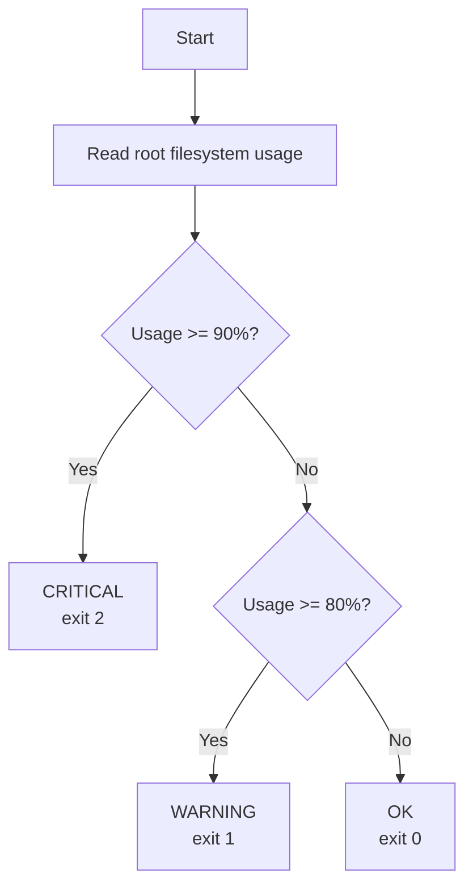
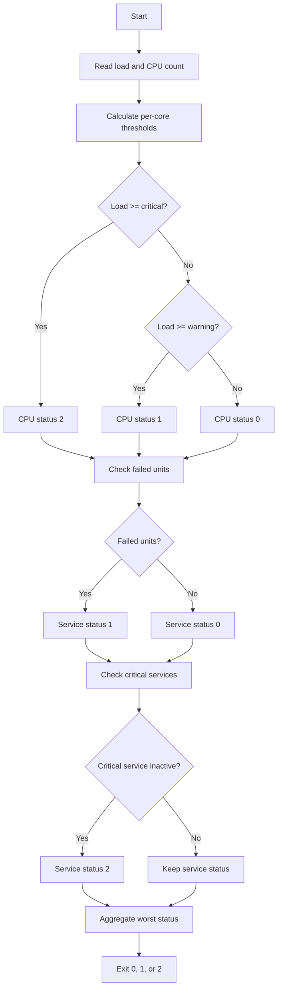
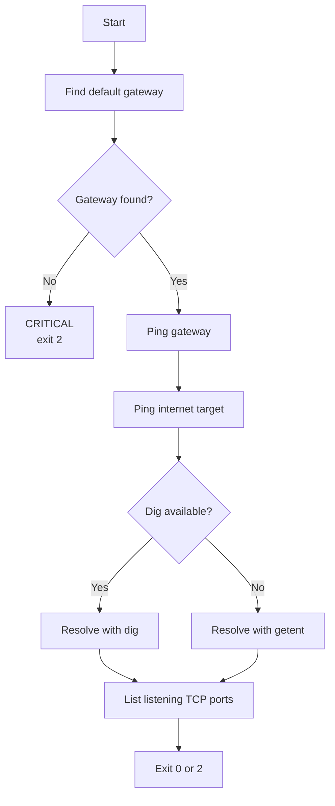

<p align="center">
  <picture>
    <source media="(prefers-color-scheme: dark)" srcset="https://shieldcn.dev/header/graph.svg?title=sys-health-check&subtitle=Small%2C+readable+health+checks+for+Linux&logo=linux&mode=dark" />
    
  </picture>
</p>

<p align="center">
  <a href="https://www.gnu.org/software/bash/"></a>
  <a href="https://www.kernel.org/"></a>
  <a href="https://systemd.io/"></a>
  <a href="#exit-code-reference"></a>
</p>

<p align="center"><em>Disk, CPU load, network, and systemd services one clear status.</em></p>

`sys-health-check` is a small collection of read-only Bash checks for Linux:

- `disk_check.sh` watches root filesystem capacity.
- `cpu_service_check.sh` watches one-minute CPU load, failed systemd units, and
  an optional list of critical services.
- `network_check.sh` verifies the default gateway, internet reachability, DNS
  resolution, and reports the top listening TCP ports.

Each check prints a plain-language result and returns a status that cron, CI,
and monitoring tools can act on.

| Check | Script | WARNING (`1`) | CRITICAL (`2`) |
|---|---|---|---|
| Root filesystem usage | `disk_check.sh` | 80% or more | 90% or more |
| One-minute load per core | `cpu_service_check.sh` | 1.5 or more | 3.0 or more |
| Failed systemd units | `cpu_service_check.sh` | any | — |
| Critical service inactive | `cpu_service_check.sh` | — | any |
| Default gateway | `network_check.sh` | — | missing or unreachable |
| Internet reachability | `network_check.sh` | — | ICMP probe fails |
| DNS resolution | `network_check.sh` | — | `dig` and `getent` fail |
| Listening TCP ports | `network_check.sh` | informational | — |

All scripts return `0` for OK, `1` for WARNING, `2` for CRITICAL, and `127` for
UNKNOWN when a required tool or data source is unavailable. The CPU/service and
network scripts aggregate severity across the checks they run.

## Table of contents

- [What I learned](#what-i-learned)
- [My choices along the way](#my-choices-along-the-way)
- [Features](#features)
- [Execution flow](#execution-flow)
- [Prerequisites and dependencies](#prerequisites-and-dependencies)
- [Installation and quick start](#installation-and-quick-start)
- [Usage and options](#usage-and-options)
- [Configuration](#configuration)
- [Exit code reference](#exit-code-reference)
- [Sample output](#sample-output)
- [Test run](#test-run)
- [Troubleshooting](#troubleshooting)

## What I learned

### 1. `chmod +x`: the difference between a text file and a program

I used to run scripts with `bash script.sh` and wonder why `./script.sh` failed
with `Permission denied`. The answer is the execute bit.

Bash can read any file you can read, so `bash script.sh` works even when the
file is not executable. But `./script.sh` asks the kernel to execute the file
directly, and that only works when the execute bit is set for your user:

```bash
chmod +x scripts/*.sh
```

The `x` in `rwx` is the execute bit. The shebang, `#!/usr/bin/env bash`, tells
the kernel which interpreter to use once execution is allowed. I also learned
that `chmod u+x` is enough when only the owner needs to run a script, and that
`chmod 777` is almost never the right answer.

### 2. Cutting through noise: small tools, one job each

`df` and `systemctl` are written for humans, not parsers. Instead of reading
entire lines, I let each command do one small job:

```bash
df -P / | awk 'NR==2 {print $5}' | sed 's/%//'
systemctl --failed --no-legend | wc -l
```

`df -P` gives stable POSIX output, one line per filesystem. `awk` selects the
second record and its fifth field, and `sed` removes the percent sign. For the
service check, `--no-legend` removes headers and footers, and `wc -l` counts the
remaining units. Inspecting the output after each stage is the shell equivalent
of testing as you go.

I also learned to state my assumptions. `NR==2` assumes root is the second line.
A more explicit version matches the mount point instead:

```bash
usage=$(df -P / | awk '$6 == "/" {gsub(/%/, "", $5); print $5}')
```

### 3. Exit codes: how a script talks to other software

An exit code is a script's API. People read the message; cron, CI, and
monitoring tools read the number.

- `0` means success.
- A non-zero value means failure, and the value can carry meaning.
- `$?` holds the status of the most recent command, so capture it immediately.
- An explicit `exit` sets the final status; without it, the last command decides.

Here, `1` means warning, `2` means critical, and `127` means the check could not
produce a trustworthy answer. That lets automation escalate differently instead
of treating every problem as the same emergency.

### 4. Bash cannot compare floats, so `awk` does it

Bash arithmetic is integer-only. A comparison such as `(( load >= 1.5 ))` fails
with an invalid arithmetic operator, and `[ "$load" -ge 1.5 ]` reports that an
integer is expected. Load average is a decimal, so the comparison needs a tool
that understands floats:

```bash
if awk "BEGIN {exit !($load_1m >= $crit_thresh)}"; then
    echo "CRITICAL: CPU load is $load_1m (Threshold $crit_thresh)"
    cpu_status=2
fi
```

`awk` does the decimal math, and `exit` turns the result into a shell status.
When the comparison is true, `!true` is `0`, which means success to `if`. When
it is false, the status is `1`.

### 5. `BEGIN` runs once, before any input

`BEGIN` is a special `awk` block that runs once before `awk` reads its first
input record. That makes it perfect for a pure calculation:

```bash
warn_thresh=$(awk "BEGIN {print $cores * $WARN_LOAD_PER_CORE}")
```

There is no file to read and no reason to wait for standard input. `BEGIN` runs
the block once and finishes. The float comparison uses the same idea; `exit`
inside `BEGIN` sets the status without needing an input file.

### 6. `nproc` counts CPUs, not processes

I assumed `nproc` returned the number of running processes. It does not: it
reports the number of processing units available to the process the CPU cores
or threads that Linux will schedule work on.

That distinction matters because load average is system-wide. Comparing a raw
load of `6.0` against a fixed threshold of `1.5` would only make sense on a
single-core machine. The script scales the thresholds by the number of cores.
With four cores, the warning threshold becomes `6.0` and the critical threshold
becomes `12.0`.

### 7. `--no-legend` keeps the service count clean

By default, `systemctl` includes a header and footer in its output. Piping that
straight into `wc -l` would count formatting lines as if they were failed
services. `--no-legend` removes the legend, leaving one line per failed unit.

The spelling matters: it is `--no-legend`, not `--no-legent`. Failed units still
carry a bullet marker in this mode, which is why the display loop uses `$2` for
the unit name. Adding `--plain` would remove the bullet and make the unit name
`$1`.

### 8. Aggregate exit codes: collect first, decide last

A multi-check script should not exit on the first problem. If it does, the reader
never sees the other results. Each check stores its own status:

```bash
cpu_status=0
svc_status=0

if (( cpu_status == 2 || svc_status == 2 )); then
    exit 2
elif (( cpu_status == 1 || svc_status == 1 )); then
    exit 1
else
    exit 0
fi
```

The final decision follows severity order: `2` beats `1`, and `1` beats `0`.
That way the caller gets one meaningful status, but every check still gets a
chance to report its finding.

## My choices along the way

### Why `(( usage >= CRIT_THRESHOLD ))` instead of `[ ... ]`

```bash
if (( usage >= CRIT_THRESHOLD )); then
```

The alternative would look like this:

```bash
if [ "$usage" -ge "$CRIT_THRESHOLD" ]; then
```

Both are valid. I chose the arithmetic form because:

- `(( ... ))` is Bash's arithmetic context. It evaluates variable names
  automatically, so `usage` needs no `$`. In `[ ... ]`, the `$` is required for
  expansion; without it, the test compares against the literal text `usage`.
- Comparisons use familiar math operators: `>=`, `>`, `<=`, `==`. The `[ ... ]`
  command uses test operators such as `-ge`, `-gt`, `-le`, and `-eq`, which are
  easy to mix up.
- The script already requires Bash because of its shebang, so there is no
  portability cost here.

| Intent | Arithmetic form | `test` form |
|---|---|---|
| Greater than or equal | `(( usage >= 80 ))` | `[ "$usage" -ge 80 ]` |
| Greater than | `(( usage > 80 ))` | `[ "$usage" -gt 80 ]` |
| Equal | `(( usage == 80 ))` | `[ "$usage" -eq 80 ]` |

`[[ ... ]]` is not a shortcut around this. Its `<` and `>` operators compare
strings, so `[[ 9 > 10 ]]` is true in lexicographic order.

### Other choices

- **`awk` instead of `bc` for floats.** `awk` was already part of the toolset,
  understands decimals, and can translate its result into an exit status.
- **Per-core thresholds instead of a raw load limit.** A load of `6.0` is busy
  on one core and relaxed on eight. Scaling by `nproc` makes the check portable.
- **`--no-legend` before counting.** Counting formatted output is fragile.
  Removing the legend first keeps the count tied to real units.
- **Collect statuses, then exit once.** Early exits are simpler in a one-check
  script, but they hide information in a multi-check script.
- **`127` for unknown states.** A missing tool or unreadable data should never
  look like a healthy system. The script fails loudly instead of returning `0`.
- **An empty `CRITICAL_SERVICES` list by default.** Service names differ between
  distributions and roles. Add your own instead of letting the script guess.
- **`dig` first, `getent` as a fallback.** `dig` gives a concise answer, while
  `getent` uses the system resolver and is available on minimal hosts. The check
  requires at least one, rather than silently skipping DNS.
- **Listening ports are informational.** The port list helps with auditing but
  does not change the health status, so a busy host is not marked unhealthy.
- **Separate scripts by concern.** Disk, CPU, services, and network fail in
  different ways and are easier to read and schedule separately.

## Features

- **Disk capacity check:** reports root filesystem usage against warning and
  critical thresholds.
- **CPU load check:** reads `/proc/loadavg` and normalizes the one-minute load
  against the number of processing units reported by `nproc`.
- **Service health check:** reports failed systemd units and optionally checks a
  list of essential services.
- **Network check:** discovers the default gateway, verifies internet
  reachability with ICMP, resolves DNS with a `dig` to `getent` fallback, and
  lists the top five unique listening TCP endpoints.
- **One exit contract:** `0`, `1`, `2`, and `127` mean the same thing across
  all scripts.
- **Worst-status aggregation:** the CPU/service and network scripts report
  findings and exit with the highest severity encountered.
- **Read-only and safe:** the checks do not modify thresholds, services, or
  filesystem state. They can run unprivileged where ICMP probing is permitted.
- **Repeatable tests:** the suite uses temporary copies plus fake `systemctl`,
  `ip`, `ping`, `dig`, and `ss` commands, so results do not depend on the host.

## Execution flow

All scripts return `127` before the flows below if a required command or data
source is unavailable.

### `disk_check.sh`



### `cpu_service_check.sh`



### `network_check.sh`



## Prerequisites and dependencies

The scripts run on Linux with Bash. Missing required commands, unreadable
`/proc/loadavg`, a failed routing-table read, or a failed `systemctl` query
produce `UNKNOWN` and exit `127`. At least one of `dig` or `getent` must be
available for the DNS check.

| Component | Required by | Purpose | Fallback | Debian/Ubuntu | RHEL/Fedora |
|---|---|---|---|---|---|
| `bash` 4+ | all | Shell interpreter | None | `bash` | `bash` |
| `df` | disk | Filesystem usage | None | `coreutils` | `coreutils` |
| `sed` | disk | Remove the `%` suffix | None | `sed` | `sed` |
| `awk` | all | Field parsing, float math | None | `gawk` or `mawk` | `gawk` |
| `nproc` | CPU | Count processing units | None | `coreutils` | `coreutils` |
| `systemctl` | CPU | Query systemd services | None | `systemd` | `systemd` |
| `wc` | CPU | Count failed units | None | `coreutils` | `coreutils` |
| `/proc/loadavg` | CPU | One-minute load average | None | kernel/procfs | kernel/procfs |
| `ip` | network | Discover the default route | None | `iproute2` | `iproute` |
| `ping` | network | ICMP reachability probes | None | `iputils-ping` | `iputils` |
| `dig` | network (optional) | DNS resolution | `getent` | `dnsutils` | `bind-utils` |
| `getent` | network (fallback) | DNS resolution | `dig` | `libc-bin` | `glibc-common` |
| `ss` | network | List listening TCP sockets | None | `iproute2` | `iproute` |
| `sort`, `head` | network | Format the listening-port list | None | `coreutils` | `coreutils` |

The test suite additionally uses `mktemp`, `env`, and `chmod`. It does not need
root, a live systemd instance, or network access because the external commands
are faked.

## Installation and quick start

There is no build step and nothing to install beyond the dependencies above.
From the repository root:

```bash
chmod +x scripts/*.sh tests/test_health_checks.sh
./tests/test_health_checks.sh
./scripts/disk_check.sh
./scripts/cpu_service_check.sh
./scripts/network_check.sh
```

Project layout:

```text
sys-health-check/
├── README.md
├── scripts/
│   ├── cpu_service_check.sh
│   ├── disk_check.sh
│   └── network_check.sh
└── tests/
    └── test_health_checks.sh
```

## Usage and options

All scripts are read-only and have no command-line flags. Configuration lives
at the top of each script so changes are visible in version control.

```bash
./scripts/disk_check.sh
echo $?

./scripts/cpu_service_check.sh
echo $?

./scripts/network_check.sh
echo $?
```

To aggregate all three scripts from a wrapper and keep the worst status:

```bash
./scripts/disk_check.sh; disk_status=$?
./scripts/cpu_service_check.sh; cpu_status=$?
./scripts/network_check.sh; network_status=$?

status=$(( disk_status > cpu_status ? disk_status : cpu_status ))
status=$(( status > network_status ? status : network_status ))
echo "Overall status: ${status}"
exit "${status}"
```

For a scheduled check, run the wrapper from cron, a systemd timer, or your
monitoring agent and route `1`, `2`, and `127` to the right alert severities.

## Configuration

Edit these values at the top of the relevant script:

| Setting | Script | Default | Purpose |
|---|---|---|---|
| `WARN_THRESHOLD` | `disk_check.sh` | `80` | Warning percentage for `/` |
| `CRIT_THRESHOLD` | `disk_check.sh` | `90` | Critical percentage for `/` |
| `WARN_LOAD_PER_CORE` | `cpu_service_check.sh` | `1.5` | Warning load per processing unit |
| `CRIT_LOAD_PER_CORE` | `cpu_service_check.sh` | `3.0` | Critical load per processing unit |
| `CRITICAL_SERVICES` | `cpu_service_check.sh` | `()` | Systemd units that must stay active |
| `TARGET_IP` | `network_check.sh` | `8.8.8.8` | Internet reachability target |
| `TARGET_DOMAIN` | `network_check.sh` | `google.com` | DNS resolution target |

Example for a host that must keep SSH and nginx running:

```bash
CRITICAL_SERVICES=(sshd nginx)
```

The list is empty by default so the script does not assume a distribution or
role. Add exact unit names from `systemctl list-unit-files '*.service'`.

## Exit code reference

| Exit code | State | Meaning |
|---|---|---|
| `0` | OK | Every check passed. |
| `1` | WARNING | Root usage is 80% or more, load is at or above 1.5 per core, or a systemd unit failed. |
| `2` | CRITICAL | Root usage is 90% or more, load is at or above 3.0 per core, a configured critical service is inactive, or a network probe fails. |
| `127` | UNKNOWN | A required command is missing, `df`, `/proc/loadavg`, or the routing table cannot be read, `systemctl` cannot be queried, or neither `dig` nor `getent` is available. |

The `0`, `1`, and `2` values follow the common Nagios/Icinga convention. `127`
is used here because it also matches the shell's command-not-found convention.
Monitoring wrappers should map `127` to their own UNKNOWN state.

## Sample output

<details>
<summary><b>Healthy run</b></summary>

```console
░▒▓ ❄️   …/sys-health-check   main ?   14:39 
❯ ./scripts/disk_check.sh
OK: Root filesystem is 42% full.
❯ ./scripts/cpu_service_check.sh
OK: CPU load is 4.32
OK: No failed systemd services.
❯ ./scripts/network_check.sh
OK: Gateway (192.168.1.1) reachable.
OK: Internet connectivity verified.
OK: DNS resolution successful.
--- Top Listening TCP Ports ---
0.0.0.0:22
0.0.0.0:80
127.0.0.1:5432
```

</details>

<details>
<summary><b>Warning run with a failed unit</b></summary>

```console
░▒▓ ❄️   …/sys-health-check   main ?   14:39 
❯ ./scripts/cpu_service_check.sh
WARNING: CPU load is 7.20 (Threshold 6)
WARNING: 1 systemd service(s) failed:
  - broken.service
❯ echo $?
1
```

</details>

<details>
<summary><b>Network failure run</b></summary>

```console
░▒▓ ❄️   …/sys-health-check   main ?   14:39 
❯ ./scripts/network_check.sh
OK: Gateway (192.168.1.1) reachable.
OK: Internet connectivity verified.
CRITICAL: DNS resolution failed for google.com.
--- Top Listening TCP Ports ---
0.0.0.0:22
❯ echo $?
2
```

</details>

## Test run

`tests/test_health_checks.sh` uses temporary copies of all three scripts with
controlled thresholds and fake `systemctl`, `ip`, `ping`, `dig`, `getent`, and
`ss` commands. It never changes the live thresholds, services, filesystem, or
network, so it is safe to run during development.

```console
░▒▓ ❄️   …/sys-health-check   main ?   14:39 
❯ ./tests/test_health_checks.sh
PASS  disk_check.sh: healthy filesystem exits 0
PASS  disk_check.sh: warning threshold exits 1
PASS  disk_check.sh: critical threshold exits 2
PASS  disk_check.sh: unreadable df exits 127
PASS  cpu_service_check.sh: healthy CPU and services exits 0
PASS  cpu_service_check.sh: high load exits 1
PASS  cpu_service_check.sh: critical load exits 2
PASS  cpu_service_check.sh: failed unit exits 1
PASS  cpu_service_check.sh: dead critical service outranks CPU warning
PASS  cpu_service_check.sh: systemctl failure exits 127
PASS  network_check.sh: healthy network exits 0
PASS  network_check.sh: unreachable gateway exits 2
PASS  network_check.sh: no internet exits 2
PASS  network_check.sh: DNS failure exits 2
PASS  network_check.sh: dig failure falls back to getent
PASS  network_check.sh: missing default route exits 2

All 16 tests passed.
```

## Troubleshooting

### `Permission denied`

**Cause:** The script does not have the execute bit.

**Fix:** `chmod +x scripts/*.sh` and run the script again.

### `UNKNOWN: required command '...' not found`

**Cause:** A required binary is missing from `$PATH`.

**Fix:** Install the package from the dependency table and confirm with
`command -v <name>`.

### `UNKNOWN: unable to query systemd`

**Cause:** `systemctl` exists but cannot reach a running systemd instance, which
is common in containers.

**Fix:** Run `disk_check.sh` on its own, use host networking and a systemd-capable
environment, or query the host from outside the container.

### `CRITICAL: No default gateway found`

**Cause:** The host has no default route, which is common in containers and
isolated build environments.

**Fix:** Check `ip route` on the host. Use host networking or a correctly
configured container network when the check must run inside a container.

### `CRITICAL: Cannot ping ...`

**Cause:** The target is unreachable, outbound ICMP is blocked, or the local user
does not have permission to create ICMP sockets.

**Fix:** Test `ping -c 1 -w 2 8.8.8.8` manually. If ICMP is blocked by policy,
treat the network check as unsuitable for that environment or extend the script
with a TCP-based probe.

### `CRITICAL: DNS resolution failed`

**Cause:** The configured target does not resolve, the resolver is unavailable,
or `dig`/`getent` returned no answer.

**Fix:** Run `dig +short google.com` or `getent hosts google.com`, inspect
`/etc/resolv.conf`, and confirm the `TARGET_DOMAIN` value.

### `UNKNOWN` from `network_check.sh`

**Cause:** A required command (`ip`, `ping`, `awk`, `ss`, `sort`, or `head`) is
missing, the routing table cannot be read, or neither `dig` nor `getent` exists.

**Fix:** Install the missing package from the dependency table and verify with
`command -v`.

### A critical service is reported down

**Cause:** The unit name is wrong, the service is stopped, or the unit is a user
service while the script queries the system manager.

**Fix:** Check with `systemctl status <unit>` and use the exact system-level unit
name in `CRITICAL_SERVICES`.

### High load, but the CPU looks idle

**Cause:** Linux load average includes processes in uninterruptible I/O wait, not
just runnable CPU work.

**Fix:** Inspect `vmstat`, `iostat`, and D-state processes before treating the
load number as pure CPU pressure.

### No critical services are checked

**Cause:** `CRITICAL_SERVICES` is empty by default.

**Fix:** Add the unit names you care about to the array near the top of
`cpu_service_check.sh`.
